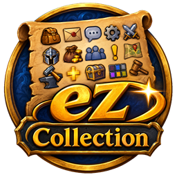

# ezCollection

Schlanke Addons für **WoW Forever**, die sich anfühlen wie das Original von Blizzard – nur bequemer. Statt eigene Fenster zu zeichnen, erweitert ezCollection Blizzards eigene: Tasche, Bank, Post, Chat, Auktionshaus, Talent- und Lehrerfenster. Jedes Modul ist ein eigenes Addon und lässt sich einzeln ein- und ausschalten. Alle brauchen die mitgelieferte Basis **ezCollection (Basis)** (Ordner `ezCore`). „ez“ steht für „easy“.

*Lightweight addons for **WoW Forever** that extend Blizzard's own windows instead of replacing them. Every module is a separate addon; all of them need the included base “ezCollection (Base)” (folder `ezCore`). German and English. Getting started in English: [docs/erste-schritte.md](docs/erste-schritte.md#english).*

**Stand: Beta.** Vieles ist im Spiel noch nicht lange erprobt – Rückmeldungen sind willkommen (unten, „Mitmachen und Unterstützen“).

**Über ezCollection:** Ich habe ezCollection für mich und meine Freunde entwickeln lassen – mit KI-Unterstützung – und teile es, weil es vielleicht auch dir das Spiel bequemer macht. Wünsche und Kritik werden geprüft und umgesetzt.

*About: I had ezCollection built for myself and my friends – with AI assistance – and I'm sharing it in case it makes the game more comfortable for you too. Wishes and criticism are reviewed and acted on.*

## Module

| Modul | Stand | Kurz |
|---|---|---|
| [ezCore](ezCore) | 1.20.0 (Mindestversion aller 18 Module: 1.15.0); Grundlage im Spiel geprüft | Gemeinsame Basis: Einführung in jedes Modul (`/ez einführung`), Einstellungen, Charakterdaten aller Twinks, Item-, Rezept- und Zauber-Wissen, Dungeon-Tabelle, Preis-Wissen, Kontakte, Chat-Kanäle und Twinks der Battle.net-Freunde, Verlauf von Beute, Gold, Post und Auktionen, Tooltip für Gegenstände und Einheiten, eigene Sammel-Fundorte (Entdecker-Datenbank), Post-Warteschlange, Teile und Blizzard-Fenster verschieben, Abschnitt „Komfort“, eigene Seiten im Zauberbuch für die Module, Auren und Abklingzeiten auch bei gesperrten Kampfdaten, Fehlerliste zum Kopieren |
| [ezBag](ezBag) | 1.16.1; Grundlage im Spiel geprüft | Die originale Blizzard-Tasche und Bank in eingerahmten, anpassbaren Gruppen, dazu Twinks und Gildenbank samt Fundort (Tasche, Bank, Gildenbank), Sammlungen und Bibliotheksbücher |
| [ezMail](ezMail) | 1.9.0; Grundlage im Spiel geprüft | Komfort für Blizzards Postfenster: Adressbuch, mehrere Briefe auswählen, gefiltertes „Alle öffnen“, mehr als 12 Stapel, Ablaufwarnung, Absender-Regeln, Einsammeln beim Öffnen, Gold überweisen, Posteingang durchsuchen, Verlauf und Statistik, Wert der Anhänge |
| [ezChat](ezChat) | 1.12.2; Neues im Spiel ungetestet | Dauerhafter Chatverlauf, Gespräche im Chatfenster, Nachrichten an Offline-Spieler (auch per Brief), anklickbare Links mit Tooltip beim Zeigen, Hervorheben, Alarme, Suche |
| [ezPanel](ezPanel) | 1.14.1; Neues im Spiel ungetestet | Info-Leiste im Originalstil mit Bausteinen; Sperren aller Twinks, Minikarten-Knöpfe, Gold- und Beute-Verlauf, Fehlerzähler |
| [ezMacro](ezMacro) | 1.11.1; Neues im Spiel ungetestet | Die besten Makros für jede Klasse und jedes Volk, Emote-Makros und -Leisten, Ränge aktualisieren, Leisten-Profile, Makros sichern und teilen |
| [ezCombat](ezCombat) | 1.17.0; im Spiel noch ungetestet | Kampfhilfen im Originalstil: nächste Aktion der Rotation (je Klasse und Talentbaum), Leuchten bei bereiter Fähigkeit, auslaufende DoTs/HoTs, Combo-Leiste, reaktive Fähigkeiten, Schlagtimer-Extras, Energie-Tick, 5-Sekunden-Regel, Totem- und Waffen-Timer (Gifte, Öle, Steine), Zahlen auf Abklingzeiten, Blizzards Schadensanzeige erweitert; Schaden, Heilung und mehr an Blizzards Gruppenrahmen |
| [ezGear](ezGear) | 1.11.0; im Spiel teilweise getestet | Bessere Ausrüstung erkennen: Pfeil auf Taschenplätzen und Questbelohnungen, Itemlevel am Charakterfenster, Gewichtung (mit ezTalent nach deiner Spielweise, dazu ob eine Waffe passt), Ausrüstungssets, Haltbarkeit, Ausrüstungs-Check der Gruppe |
| [ezMerchant](ezMerchant) | 1.10.0; im Spiel noch ungetestet | Händler und Lehrer: „Alles lernen“, „Was kommt wann“ und „Wo kommt was“ (Seiten im Zauberbuch), breiteres Händlerfenster, automatisch reparieren |
| [ezSocial](ezSocial) | 1.6.2; im Spiel noch ungetestet | Gruppensuche mit Klassen, Rollen und Stufen; Gruppen-Nachrichten aus dem Chat nach Dungeon |
| [ezQuest](ezQuest) | 1.9.0; Grundlage im Spiel geprüft | Ergänzt Questie: Stufe in den NPC-Dialogen, Quest-Gegenstände, automatisch annehmen und abgeben, Leveling-Route durch dein Questlog (Ziele als Gebiet mit Rundgang von Nest zu Nest), Quest-Erfahrung auf der Erfahrungsleiste, Quests mit der Gruppe teilen |
| [ezMap](ezMap) | 1.15.1; im Spiel noch ungetestet | `/way` mit Blizzards Kartenmarkierung, ein Knopf an der Weltkarte mit Symbolen, Routenlinien mit Pfeilen, Flugzeiten, Lehrer und Dungeoneingänge als Ziel, Ziele im Menü „Aufspüren“, eigene Sammel-Fundorte, kompakte Minikarte |
| [ezCraft](ezCraft) | 1.13.1; im Spiel noch ungetestet | Abschnitt und Seitenreiter in Blizzards Berufefenster: Material aller Twinks, wer es herstellen kann, Einkaufsliste, Skill-Farben, Materialkosten, Entzaubern |
| [ezBuff](ezBuff) | 1.11.0; im Spiel noch ungetestet | Meldet außerhalb des Kampfes fehlendes Buff-Essen, Fläschchen und Klassen-Buffs; Knopf an Blizzards Buff-Leiste; Abschnitt „Gruppe“ an Blizzards Gruppenrahmen (Durchbuffen, Segen je Klasse und Spieler, ohne Wahl nach Klasse und Rolle) |
| [ezLoot](ezLoot) | 1.11.0; im Spiel noch ungetestet | Schneller plündern, Plündern- und Würfelfenster mit Itemlevel und „besser“, Beute-Verlauf |
| [ezBars](ezBars) | 1.9.2; Grundlage im Spiel geprüft | Zusatzleisten im Blizzard-Stil mit frei wählbaren Spalten und Reihen |
| [ezAuction](ezAuction) | 1.7.1; im Spiel noch ungetestet | Blizzards Auktionshaus mit Preisgedächtnis, Einkaufslisten, Verkaufsliste, „unterboten“ und Verlauf |
| [ezTalent](ezTalent) | 0.8.1, neu; im Spiel ungetestet | Talent- und Vermächtnis-Vorlagen an Blizzards Fenstern (speichern, als Vorschau anwenden, teilen), Auswirkungen der gewählten Talente, Empfehlung nach Spielweise mit Fragebogen und Bewerten des eigenen Baums, Übersicht der Twinks |
| [ezHeal](ezHeal) | 0.8.0, neu; im Spiel ungetestet | Heilen, Bannen, Wiederbeleben und Buffen per Klick auf Blizzards Gruppen- und Raidrahmen: Vorlagen je Klasse für Blizzards Klick-Zaubern, eigene HoTs am Rahmen |

Dazu zwei **Speicher-Ordner** ohne eigene Funktionen, die immer mit installiert werden: `ezWorld` (Entdecker-Datenbank: Beute, Händler, Lehrer, Fundorte, Eingänge, Flugzeiten) und `ezMarket` (eigene Auktionspreise je Realm und Seite). Beide liest und schreibt nur ezCore. Dazu der Daten-Ordner `ezData` (Version 0.1.0, neu): die vom Projekt geprüften und zusammengeführten **Beiträge anderer Spieler** (Fundorte, Beute-Zählung, Händler, Lehrer …), nur Nummern und Zahlen, ohne gespeicherte Daten. ezCore lädt ihn einmal nach dem Einloggen (nie im Kampf) und nennt seine Angaben „aus Beiträgen (n Spieler)“, getrennt von „bei dir“; ohne ihn läuft alles weiter. Noch sind keine Beiträge darin.

Alle Einstellungen stehen an einem Ort: **Esc » Optionen » AddOns » ezCollection**, darunter eine Seite je Modul – jede gleich aufgebaut: „Allgemein“, die Themen des Moduls, „Erweitert“. Jede Funktion hat einen sichtbaren Knopf, Reiter oder Pfeil; Rechtsklick und Befehle gibt es nur zusätzlich.

## Erste Schritte

Beim ersten Einloggen bietet ezCollection einmal eine kurze **Einführung** an – eine Blase am Addon-Fach der Minikarte mit „Kurz“ (alle Module auf einer Seite), „Einzeln“ (Modul für Modul, je mit seiner Einstellungsseite) und „Später“. Jederzeit erreichbar über **Esc » Optionen » AddOns » ezCollection » Einführung**, mit `/ez einführung` (englischer Client `/ez intro`; `/ez einführung kurz`, `/ez einführung bag` …) und über den Knopf „Einführung“ oben auf jeder Modulseite. Die Seite „Einführung“ nennt auch alle Abläufe ohne Klick mit ihrem Stand – ein Häkchen schaltet sie ein oder aus – und erklärt „Mithelfen“.

**Abläufe ohne Klick sind ab Werk aus:** Was ohne deinen Klick Gold kostet, verkauft, Briefe sendet oder Blizzards Einstellungen umstellt, schaltest du selbst ein. Zwei Ausnahmen, beide mit Hinweis im Chat und eigenem Schalter: ezHeal stellt „Selbstwirken“ auf „Tastendruck“, damit eine Heilung außer Reichweite nicht dich trifft, und hält Blizzards „Menü“ auf dem einfachen Rechtsklick, damit er an den Rahmen immer das Menü öffnet (nicht neben einem anderen Addon für Klick-Zauber). Eine Erklärblase mit dem Knopf „Einschalten“ meldet jeden solchen Ablauf einmal am passenden Blizzard-Fenster.

Ausführlich, je Modul in zwei, drei Sätzen: [docs/erste-schritte.md](docs/erste-schritte.md) (Deutsch und Englisch).

## Befehle

Jedes Modul hat einen Befehl, der seine Einstellungen öffnet; `hilfe` (bzw. `help`) dahinter zeigt alle seine Befehle, `status` den Stand. Kurzformen gelten nur, wenn kein anderes Addon sie belegt. Der Addon-Knopf an der Minikarte öffnet die Module ebenfalls (Linksklick: Fenster oder Hauptfunktion, Rechtsklick: Einstellungen; jeder Tooltip nennt den Befehl).

| Modul | Befehl | Außerdem |
|---|---|---|
| ezCollection (Basis) | `/ezcollection`, `/ez` | `/ez <modul>` öffnet die Seite eines Moduls (`/ez bag`, `/ez mail` …), `/ez status`, `/ez einführung`, `/ez fehler` (`kopieren`, `leeren`), `/ez chars`, `/ez vergessen Name` (Charakter aus allen Modulen entfernen), `/ez beitrag`, `/ez mithelfen` |
| ezBag | `/ezbag`, `/eb` | `/eb status`, `/eb hilfe` |
| ezMail | `/ezmail`, `/ezm` | `/ezm regel Name vertraut\|auslassen\|zurueck\|weg`, `/ezm statistik heute\|woche\|monat\|gesamt` |
| ezChat | `/ezchat`, `/ezc` | `/ezchat suche Text`, `/ezchat stichwoerter`, `/ezchat status` |
| ezPanel | `/ezpanel`, `/ep` | `/ep status`, `/ep standard` |
| ezMacro | `/ezmacro`, `/ezmc` | `/ezmacro optionen`, `sichern`, `werkzeuge`, `raenge`, `ansagen`, `einklick`, `einetaste`, `angeln`, `pruefen`, `status` |
| ezCombat | `/ezcombat`, `/ezk` | `/ezk test`, `/ezk status`, `/ezk bericht [gruppe\|gilde]`, `/ezk werte` (englisch `values`) |
| ezGear | `/ezgear`, `/ezg` | `/ezg gewichtung`, `/ezg set Name`, `/ezg angeln`, `/ezg test [Link]`, `/ezg status` |
| ezMerchant | `/ezmerchant`, `/ezh` | `/ezh reparieren`, `/ezh status` |
| ezSocial | `/ezsocial`, `/ezs` | `/ezs chat`, `/ezs status` |
| ezQuest | `/ezquest`, `/ezq` | `/ezq auto`, `sortieren`, `stufe`, `neu`, `dungeon`, `/ezq route` (Leveling-Route), `/ezq status` |
| ezMap | `/ezmap` | `/way [Zone] x y [Name]` bzw. `/ezway`, `/ezmap flug`, `/ezmap lehrer`, `/ezmap status` |
| ezCraft | `/ezcraft` | `/ezcraft liste`, `leeren`, `fenster`, `tooltip`, `rezept`, `post`, `status` |
| ezBuff | `/ezbuff` | meldet im Chat, was fehlt; `/ezbuff optionen`, `test`, `status` |
| ezLoot | `/ezloot`, `/ezl` | `/ezl verlauf`, `schnell`, `auto`, `itemlevel`, `boe`, `besser`, `würfel`, `tooltip`, `status` |
| ezBars | `/ezbars` | `/ezbars tasten`, `verschieben`, `status`, `plaetze` |
| ezAuction | `/ezauction`, `/eza` | `/eza listen`, `/eza status`, `/eza verlauf` |
| ezTalent | `/eztalent`, `/ezt` | `/ezt twinks`, `/ezt status`, `/ezt werte` (englisch `values`) |
| ezHeal | `/ezheal` | `/ezheal vorschau`, `tasten`, `anwenden`, `zurück`, `anfang`, `fenster`, `status` |

## Bearbeitungsmodus

ezCollection und Blizzards Bearbeitungsmodus (Esc » Bearbeitungsmodus) arbeiten zusammen:
- Kein Modul vergrößert oder registriert ein Fenster, das der Bearbeitungsmodus verwaltet (Aktionsleisten, Einheitenfenster, Chat, Minikarte, Buffs, Schlag-Timer …), und keines verschiebt eines – mit einer Ausnahme: ezPanels „Platz oben für die Leiste“ rückt Fenster am oberen Rand um die Höhe der Leiste nach unten, solange sie in Blizzards Standardlage stehen (nie im Kampf, abschaltbar, Blizzards eigene Lage als Ausgang). Was du im Bearbeitungsmodus selbst verschiebst, bleibt dort.
- Was an solchen Fenstern hängt, wandert mit: ezCombats DoT-Reihe (Zielfenster), Combo-Leiste (Spielerfenster) und Schlagtimer-Extras, ezChats Gesprächsansicht und Knöpfe sowie die Emote- und Ansage-Leisten von ezMacro (Chatfenster), ezBags Platzanzeige (Rucksack-Knopf der Taschenleiste).
- Eigene Teile, die man frei hinstellen kann (ezCombats DoT-Reihe, Combo-Leiste und Symbol „wieder bereit“, ezBars' Leisten, ezMaps Flugleiste), zeigen im Bearbeitungsmodus einen Rahmen wie Blizzards eigene Systeme und lassen sich dort verschieben; ohne Bearbeitungsmodus über den Knopf „Verschieben“ auf ihrer Einstellungsseite.
- Eigene Fenster (Tasche, Bank, Gildenbank, ezBag-, ezChat- und Makro-Fenster, freie Emote-Leisten, ezPanel-Leiste) gehören nicht zum Bearbeitungsmodus; sie verschiebt man direkt.

## Zusammenarbeit mit anderen Addons

ezCollection braucht kein fremdes Addon – jedes Modul braucht nur die mitgelieferte Basis (`ezCore`).

- **Daten zur Laufzeit:** Läuft Questie oder AtlasLoot Classic Forever, fragt ezCollection sie während des Spiels ab und nennt die Quelle an jeder Angabe („laut Questie“). Anzeigen über LibDataBroker erscheinen als Bausteine in ezPanels Leiste.
- **Rücksicht:** Erledigt ein laufendes Addon schon dieselbe Aufgabe, hält sich das betreffende Modul an dieser Stelle zurück und sagt es im Tooltip bzw. in seinem `status`; wo es passt, holt „Trotzdem zeigen“ die Funktion zurück.

### Empfohlene Addons – sie ergänzen ezCollection

ezCollection baut bewusst nicht nach, was diese Addons mit gepflegten Daten gut können; laufen sie, arbeiten die ez-Module mit ihnen zusammen. Alle sind freiwillig.

*Recommended addons that complement ezCollection (all optional):*

| Addon | Wofür / What for | Zusammenspiel mit ezCollection |
|---|---|---|
| [Questie](https://www.curseforge.com/wow/addons/questie) | Quests auf Karte und Minikarte / quests on the map | ezQuest ergänzt seine Fenster; Fundorte, Beute und Eingänge „laut Questie“ in ezMap und ezLoot |
| [AtlasLoot Classic Forever](https://www.curseforge.com/wow/addons/atlasloot-forever) | Beute und Rezepte nachschlagen / loot and recipe browser | ezCraft und ezLoot fragen es ab, Angaben „laut AtlasLoot“ |
| [RareScanner](https://www.curseforge.com/wow/addons/rarescanner) | Seltene Gegner und Schätze / rares and treasures | sein Knopf sitzt in ezPanels Leiste |
| [HandyNotes](https://www.curseforge.com/wow/addons/handynotes) mit [HandyNotes: WoW Forever](https://www.curseforge.com/wow/addons/handynotes-wow-forever) | Kartenpunkte / map notes | gepflegte Punkte; ezMap zeichnet eigene Punkte nur auf Wunsch |
| [Atlas](https://www.curseforge.com/wow/addons/atlas) | Dungeonkarten / dungeon maps | Knopf als Baustein in ezPanels Leiste |
| [Deadly Boss Mods](https://www.curseforge.com/wow/addons/deadly-boss-mods) | Boss-Timer und Warnungen / boss timers | ezMacros Ansage „Pull“ nutzt seinen Befehl |
| [Details! Damage Meter](https://www.curseforge.com/wow/addons/details) | Schadensmesser / damage meter | ezCombat erweitert nur Blizzards eigene Schadensanzeige; wer mehr Tiefe will, nimmt Details |
| [BugSack](https://www.curseforge.com/wow/addons/bugsack) | Lua-Fehler sammeln / error collector | hilft bei Fehlermeldungen; ezCollection hat zusätzlich eine eigene Fehlerliste |

## Mitmachen und Unterstützen

ezCollection ist eine **Beta**. Fühl dich frei zu kommentieren, zu kritisieren, Fehler zu melden und dir etwas zu wünschen – jede Meldung wird gelesen, Wünsche und Kritik werden geprüft und umgesetzt. Entwickelt wird mit KI-Unterstützung (Claude von Anthropic); das macht schnelle Antworten auf Meldungen möglich.

- **Fehler melden:** in den Kommentaren auf CurseForge bzw. Wago oder als Issue in diesem Repo. Am meisten hilft die Fehlerliste aus dem Spiel: Esc » Optionen » AddOns » ezCollection » Erweitert » „Fehlerliste zum Kopieren“, dazu ein Bildschirmfoto und was du gerade getan hast.
- **Wünsche und Kritik:** ebenfalls in den Kommentaren oder als Issue – gern mit dem Fenster, an dem dir etwas fehlt.
- **Bildschirmfotos** in öffentlichen Kommentaren: Namen von Charakteren, Gilden und Mitspielern bitte unkenntlich machen.
- **Mithelfen – Datenbank schicken** (freiwillig, einmalig oder öfter): normal spielen, dann im Spiel „Beitrag vorbereiten“ anklicken (Esc » Optionen » AddOns » ezCollection » Erweitert, oder `/ez beitrag`) und den anonymen Text in ein Issue mit der Vorlage „Beitrag zur Datenbank“ einfügen. Er enthält nur Nummern und Zahlen zur Spielwelt (Beute, Händler, Lehrer, Fundorte, Eingänge, Flugzeiten, mit Build und Tag), keine Namen von Charakteren, Gilden oder Realms, kein Konto, keine Uhrzeiten, keine Chat- oder Brieftexte. Versandt wird nie etwas von selbst. Anleitung: [docs/beitragen.md](docs/beitragen.md).
- **Mithelfen – Werte messen** (freiwillig, jede Stufe): je Klasse auf zwei verschiedenen Stufen ohne Ausrüstung (außer Hemd und Wappenrock) und ohne Stärkungszauber das Talentfenster einmal öffnen, `/ezt werte` und `/ezk werte` eingeben und den Text in ein Issue mit der Vorlage „Werte messen“ kopieren. Daraus entstehen die berechneten Talentverteilungen und Rotationen. Anleitung: [docs/beitragen.md](docs/beitragen.md#werte-messen-für-helfer-deutsch).
- **Unterstützen:** Wer mag, spendiert einen Kaffee: [ko-fi.com/blackwolfdesign](https://ko-fi.com/blackwolfdesign)

*Help out (optional): play normally, click “Prepare contribution” in the game (Esc » Options » AddOns » ezCollection » Advanced, or `/ez contribute`) and paste the anonymous text into an issue with the template “Contribution to the database”. It holds numbers about the game world only – no names of characters, guilds or realms, no account, no times of day, no chat or mail texts; nothing is ever sent by itself. Measuring values: for each class, on two different levels without gear (except shirt and tabard) and without buffs, open the talent window, type `/ezt values` and `/ezk values` and paste the text into an issue with the template “Measure values”. Guide: [docs/beitragen.md](docs/beitragen.md#for-helpers-english).*

## Installation

Den Ordner `ezCore`, dazu immer die Speicher-Ordner `ezWorld` und `ezMarket` (ohne `ezWorld` speichert die Entdecker-Datenbank nichts, ohne `ezMarket` bleiben die Preise in ezCores Datei) und die gewünschten Module (z. B. `ezBag`, `ezMail`) nach `World of Warcraft\_forever_\Interface\AddOns\` kopieren; wer die Beiträge anderer Spieler nutzen will, dazu `ezData`. Ohne `ezCore` lädt kein Modul. Das Paket von CurseForge bzw. Wago enthält alle 22 Ordner. Ein neuer Ordner braucht einen Neustart von WoW (ein /reload reicht nicht).

Für Entwickler: die gemeinsame Basis und ihre Dienste beschreibt [docs/ezcore.md](docs/ezcore.md), die Regeln für Oberflächen [docs/design-system.md](docs/design-system.md), wie ezCollection Blizzards Regeln für Addons einhält [docs/blizzard-regeln.md](docs/blizzard-regeln.md); Beiträge: [docs/beitragen.md](docs/beitragen.md).

## Lizenz

Eigene Lizenz „ezCollection License 1.0“ – siehe [LICENSE](LICENSE); maßgeblich ist der englische Text, eine unverbindliche deutsche Übersetzung steht in [docs/lizenz-deutsch.md](docs/lizenz-deutsch.md). Kurz: Benutzen, Lesen und Ändern für den Eigengebrauch sind erlaubt, ebenso eigene Module, die zur Laufzeit mit ezCollection zusammenarbeiten (ohne Code, Daten oder Bilder daraus). Weitergeben, Hochladen, Verkaufen und Kopieren in andere Projekte nur mit schriftlicher Erlaubnis des Autors. Wer etwas beiträgt (Pull Request, Übersetzung, gesammelte Spieldaten), räumt dem Autor das Recht ein, es als Teil von ezCollection zu nutzen und weiterzugeben, und behält seine eigenen Rechte daran (Abschnitt 3 b).

*Own licence “ezCollection License 1.0” – see [LICENSE](LICENSE). In short: using, reading and changing it for your own use are allowed, and so are your own modules that work with ezCollection at runtime (without its code, data or images). Passing it on, uploading, selling and copying into other projects need written permission from the author. Contributors grant the author the right to use and pass on their contribution as part of ezCollection and keep their own rights (section 3 b).*
